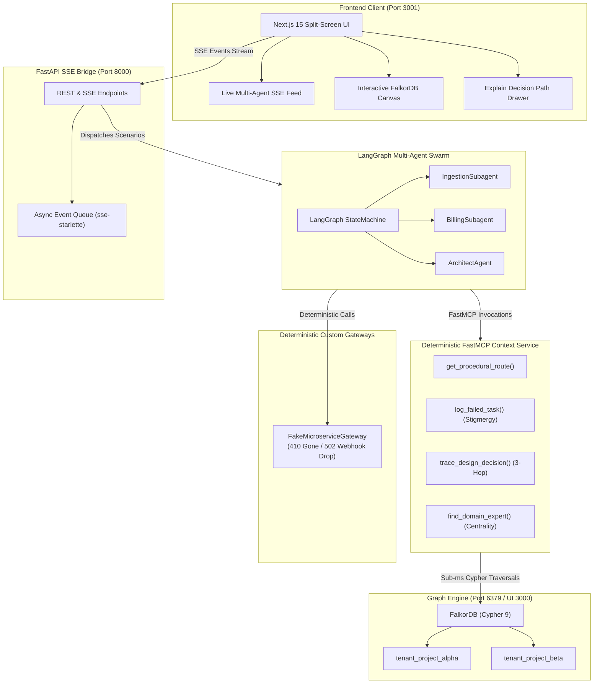

# Active Engineering Memory Layer

Graph guardrails and procedural memory for autonomous coding agents, built on FalkorDB.

[](https://falkordb.com)
[](https://modelcontextprotocol.io)
[](https://langchain.com)
[](https://fastapi.tiangolo.com)
[](https://nextjs.org)
[](backend/tests)

## Problem and approach

When autonomous coding agents refactor code or run operational scripts, they rarely know the history behind the repository:
- Architecture Decision Records (ADRs) sit in forgotten markdown files.
- Incident postmortems stay closed in ticket trackers.
- Production constraints hide inside PR review comments.

Embedding-based search misses these relationships. An agent asking how to optimize a retry loop might find generic advice urging it to batch API calls, missing a pull request comment warning that an external banking gateway drops webhooks when requests are batched.

Active Engineering Memory Layer stores engineering context as a connected graph in FalkorDB. When an agent runs, FastMCP tools query this graph to:
1. Stop unsafe refactors by checking multi-hop constraint paths (`CodeModule -> Decision -> JiraTicket -> VCSComment <- Engineer`).
2. Update operational routes when endpoints fail. If an agent hits an HTTP 410 on a deprecated endpoint, it marks the route in the graph and points to the replacement so other agents avoid the same mistake.

## Architecture



## Route updates across sessions

When `IngestionSubagent` hits an `HTTP 410 Gone` on `/v1/legacy-auth`, it updates FalkorDB directly:
1. It creates a `Failure` node with the error message and timestamp.
2. It sets the status of `/v1/legacy-auth` to `DEPRECATED` and marks the existing step `BLOCKED`.
3. It creates a `SUPERSEDED_BY` edge to the replacement endpoint (`/v3/oauth/token`) and links the module to the new endpoint with an active `EXECUTES_STEP` edge.

When `BillingSubagent` runs later in a separate session, it queries FalkorDB for the active route and receives `/v3/oauth/token` on its first attempt, avoiding the deprecated endpoint.

## Core Cypher queries

### 1. 3-hop constraint guardrail (`trace_design_decision`)

```cypher
MATCH (m:CodeModule {name: $module_name})-[:IMPLEMENTS]->(d:Decision)-[:FORCED_BY]->(j:JiraTicket)-[:EXPLAINED_IN]->(v:VCSComment)<-[:AUTHORED]-(e:Engineer)
OPTIONAL MATCH (g:Guardrail)-[:PROTECTS]->(m)
RETURN d.id AS decision_id,
       d.status AS decision_status,
       d.summary AS decision_summary,
       j.id AS jira_id,
       v.id AS vcs_id,
       v.text AS vcs_text,
       e.name AS engineer_owner,
       e.role AS engineer_role,
       [m.name, d.id, j.id, v.id, e.name] AS path_nodes;
```

Checks whether a module has active `SUBOPTIMAL_WORKAROUND` invariants before an agent attempts code edits. Runs in roughly 0.15ms in FalkorDB.

### 2. Failure record and route update (`log_failed_task`)

```cypher
MATCH (m:CodeModule {name: $module_name})-[r:EXECUTES_STEP]->(oldApi:APIEndpoint {name: $failed_endpoint})
SET r.status = 'BLOCKED', r.weight = 0.0, oldApi.status = 'DEPRECATED'
MERGE (a:Agent {name: $agent_name})
CREATE (f:Failure {id: $ep_id, session_id: $session_id, error: $error_message, timestamp: $ts})
CREATE (a)-[:LOGGED_EPISODE]->(f)
CREATE (f)-[:DEPRECATES {weight: 0.0}]->(oldApi)
MERGE (newApi:APIEndpoint {name: $replacement_endpoint})
MERGE (oldApi)-[rSup:SUPERSEDED_BY]->(newApi)
SET rSup.confidence = 1.0
CREATE (m)-[:EXECUTES_STEP {status: 'ACTIVE', weight: 1.0, self_healed: true}]->(newApi)
RETURN f.id AS episode_id;
```

Atomically records the failure episode and updates execution edges. Runs in roughly 0.25ms in FalkorDB.

### 3. Domain expert centrality (`find_domain_expert`)

```cypher
MATCH (m:CodeModule {name: $module_name})
MATCH (eng:Engineer)-[r]-(item)
WHERE (item = m)
   OR (item:Decision AND (m)-[:IMPLEMENTS]->(item))
   OR (item:JiraTicket AND (m)-[:IMPLEMENTS]->()-[:FORCED_BY]->(item))
   OR (item:VCSComment AND (m)-[:IMPLEMENTS]->()-[:FORCED_BY]->()-[:EXPLAINED_IN]->(item))
   OR (item:Service AND (item)-[:CONTAINS]->(m))
RETURN eng.name AS expert_name,
       eng.role AS role,
       eng.email AS email,
       count(r) AS centrality_score,
       collect(DISTINCT type(r)) AS relations
ORDER BY centrality_score DESC
LIMIT 1;
```

Finds the owner of a module by relationship count. In the demo data, this resolves to `Aarav` (Staff Systems Architect) with centrality score 5 (`['OWNS', 'MAINTAINS', 'AUTHORED', 'RESOLVED']`).

## Demo walkthrough

### Act 1: Cross-session learning

1. Click "Run Act 1: Session 1 (Hit 410 & Write Stigmergy)":
   - `IngestionSubagent` inspects `TokenIngestionWorker` and calls `/v1/legacy-auth`.
   - The fake gateway returns `HTTP 410 Gone: Endpoint /v1/legacy-auth is discontinued. Migrate to /v3/oauth/token`.
   - The agent calls `log_failed_task`.
   - The feed displays a cyan `GRAPH_MUTATION` card, `/v1/legacy-auth` turns red (`DEPRECATED`), and the agent retries on `/v3/oauth/token` with 200 OK.
2. Click "Run Act 1: Session 2 (Zero-Shot Self-Healing Route)":
   - `BillingSubagent` starts in a clean session.
   - It queries FalkorDB for the active route. The graph routes it straight to `/v3/oauth/token` using the edge created in Session 1.
   - The call succeeds without repeating the 410 error.

### Act 2: 3-hop constraint guardrail

1. Click "Run Act 2: Refactor PaymentRetryWorker (3-Hop Guardrail)":
   - The agent is asked to optimize the polling loop in `PaymentRetryWorker` by switching to batch charges.
   - `ArchitectAgent` queries `trace_design_decision("PaymentRetryWorker")`.
   - FalkorDB follows the 3-hop chain:
     - `PaymentRetryWorker` -> `dec_19` (status: `SUBOPTIMAL_WORKAROUND`)
     - `dec_19` -> `PAY-409` (incident postmortem)
     - `PAY-409` -> `pr_882_c4` (VCS comment) <- `Aarav` (Staff Architect)
   - The "Explain Decision Path" drawer opens, showing:
     - The 3-hop path nodes.
     - Aarav's review comment: "DO NOT upgrade to /v2/charge/batch here! Legacy partner bank gateway drops webhooks if batched > 1."
     - The Cypher traversal and expert profile.
   - The agent stops the refactor, preserving the synchronous charge loop.

## Quickstart and setup

### Port allocation
- FalkorDB database: `localhost:6379`
- FalkorDB browser UI: `localhost:3000`
- FastAPI backend (SSE): `localhost:8000`
- Next.js web application: `localhost:3001`

### Option 1: Local script launch

```bash
# Setup python and node environments
python3 -m venv backend/.venv
backend/.venv/bin/pip install -r backend/requirements.txt
cd frontend && npm ci && cd ..

# Start FalkorDB container
docker run -p 6379:6379 -p 3000:3000 -d --name falkordb falkordb/falkordb:latest

# Run demo launcher
./start_demo.sh
```

The launcher checks FalkorDB on port 6379, seeds both tenant graphs, and starts FastAPI and Next.js. Open **http://localhost:3001**.

### Option 2: Docker compose

```bash
docker compose up --build
```

Open **http://localhost:3001** and select "Reset & Seed Graph". The compose stack exposes FalkorDB on `6379`, the browser UI on `3000`, FastAPI on `8000`, and Next.js on `3001`.

### Option 3: Manual startup

1. Start FalkorDB:
```bash
docker run -p 6379:6379 -p 3000:3000 -d --name falkordb falkordb/falkordb:latest
```

2. Start the backend:
```bash
python3 -m venv backend/.venv
backend/.venv/bin/pip install -r backend/requirements.txt
cd backend && .venv/bin/python -m uvicorn app.main:app --host 0.0.0.0 --port 8000
```

3. Start the frontend:
```bash
cd frontend
npm ci
npm run dev -- -p 3001
```

Open **http://localhost:3001**.

## Using the workspace

The main screen has three prepared agent traces across the top, the live event ledger on the left, and the selected tenant graph on the right.

1. Start with **Billing Core** (`tenant_project_alpha`) or **Logistics & Carriers** (`tenant_project_beta`) in the Graph selector. These are seeded demo graphs.
2. Select trace **01** to record the deprecated endpoint and its replacement. Select **02** afterward to see a new run use the route learned by trace 01. Select **03** to see the payment refactor stopped by a saved guardrail.
3. Open **Runs** to inspect the event timeline from a completed run. Run history is stored in this browser; selecting a run restores its events in the ledger.
4. Open **Cypher** for graph exploration. **Prepared queries** load examples you can edit before running. **Build with Cypher** lets you choose a new graph name such as `my_custom_graph`, then type and run your own OpenCypher. New graph names start empty and appear in the top Graph selector; use `CREATE` / `MERGE` to add nodes and edges. The canvas refreshes after a successful query.
5. In custom mode, **Load graph starter** inserts an editable example that creates a module, endpoint, and relationship. Replace it with your own query as needed. `MATCH (n) RETURN n LIMIT 25` is a useful first read query on an existing graph.

Prepared traces and seeded graph content are intentionally deterministic demo data. Custom Cypher runs directly against the selected graph, so `CREATE`, `SET`, and `DELETE` statements change that graph; keep experiments in a new custom graph if you want to preserve the two demos. **Reset graph** reseeds the currently selected graph with demo data.

### Company Brain and shared agent memory

Use **Brain** in the top action bar:

- **Ask company** retrieves graph-connected evidence and displays source citations and relationship paths. Try “Who owns PaymentRetryWorker, and why is batching unsafe?” on Billing Core. Set `GEMINI_API_KEY` in `.env` to enable Gemini's evidence-only answer layer; without it, graph retrieval stays available.
- **Add source** stores a document, ticket, or chat excerpt with a stable source ID. Reusing the same source ID updates it. Import local `.txt`, `.md`, `.json`, and `.csv` files from the browser or add a record manually. No Slack/GitHub or cloud service connector is used. Connect records with entities such as `PaymentRetryWorker:module, Aarav:person` and relationships such as `Aarav|person|OWNS|PaymentRetryWorker|module`.
- **Agent memory & handoffs** writes episodic (what happened), semantic (what is true), or procedural (how to do it) memory. A conversation ID groups durable turns. Create a handoff with a task and JSON state, then claim or complete it; version checks prevent stale concurrent updates.
- In **Ask company**, **Run two-agent handoff** streams `ContextAgent` retrieval → persisted memory and handoff → `ResearchAgent` claim, recall, and completion in one LangGraph run.

Every completed prepared trace also saves an episodic run summary into the selected tenant and user memory, so a later agent can recall what happened even after the browser session ends.

For Gemini-backed answers, copy `.env.example` to `.env`, add your `GEMINI_API_KEY`, and restart the backend. Docker Compose passes this key only to the backend. The current implementation uses Google's Gemini `generateContent` API and sends the question plus retrieved source excerpts; it does not enable model-initiated web search or other external integrations.

The FastAPI endpoints are documented in [`docs/API.md`](docs/API.md). The demo uses `demo_user` as its user scope; user IDs are not authentication, so production deployments need an identity and authorization layer.

## Automated tests

Run frontend tests from `frontend/`. Backend tests require FalkorDB running on port 6379.

### Backend test suite (35 tests)
```bash
backend/.venv/bin/pytest -v backend/tests
```
- `backend/tests/test_contracts.py` (10 tests)
- `backend/tests/test_phase1_graph_seed.py` (6 tests)
- `backend/tests/test_phase2_fake_api_and_mcp.py` (5 tests)
- `backend/tests/test_phase3_langgraph_swarm.py` (6 tests)
- `backend/tests/test_phase4_fastapi_sse.py` (7 tests)
- `backend/tests/test_e2e_demo_flow.py` (1 test)

### Frontend test suite (20 tests)
```bash
cd frontend && npm test
```
- `contracts.test.ts` (6 passed)
- `CypherPlaygroundModal.test.tsx` (3 passed)
- `Dashboard.test.tsx` (11 passed)

### Production build
```bash
cd frontend && npm run build
```

## Hackathon submission details

- **Source repository:** [github.com/ishan8351/Graph-Hacks-Hackathon](https://github.com/ishan8351/Graph-Hacks-Hackathon)
- **Tracks:** Agent Memory and Coordination; Agents That Act on Connected Data.
- **Graph data model:** Each tenant is an isolated FalkorDB graph. Nodes represent synthetic `Service`, `CodeModule`, `APIEndpoint`, `Decision`, `JiraTicket`, `VCSComment`, `Engineer`, `Team`, `Guardrail`, `Incident`, `Agent`, and `Failure` records. Relationships such as `IMPLEMENTS`, `FORCED_BY`, `EXPLAINED_IN`, `AUTHORED`, `PROTECTS`, `EXECUTES_STEP`, `SUPERSEDED_BY`, and `LOGGED_EPISODE` store decision provenance, operational routes, and failure history. Synthetic data is generated by [seed_enterprise_graph.py](backend/app/db/seed_enterprise_graph.py); indexes and reference queries are in [schema.cypher](contracts/schema.cypher).
- **Core Cypher and graph algorithms:** The application uses multi-hop decision path tracing, expert centrality ranking, and route mutation queries implemented in [memory_mcp.py](backend/app/mcp/memory_mcp.py). Schema definitions and queries are in [contracts/schema.cypher](contracts/schema.cypher).
- **Local setup:** The Docker Compose and manual setup instructions above provide the local run path.
- **Demo video:** Record the working project and add the public video URL here before submitting.
- **AI coding assistant disclosure:** OpenAI Codex was used to review and modify the UI and documentation.
