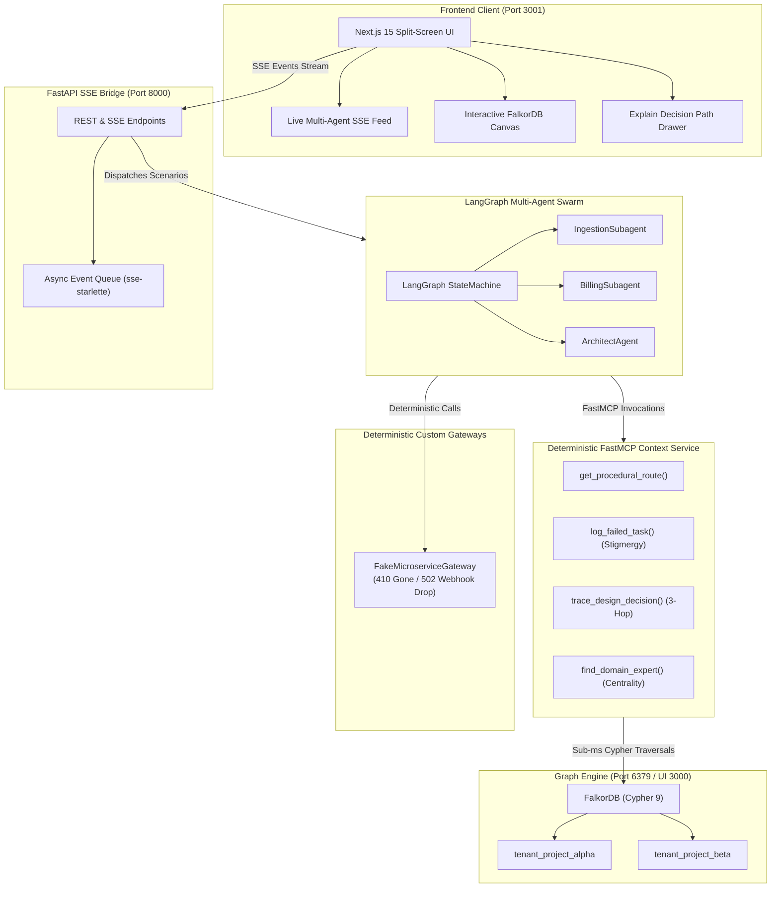

# Active Engineering Memory Layer
### *Turning Passive Engineering Knowledge into Active Graph Guardrails & Self-Healing Procedural Memory*

[](https://falkordb.com)
[](https://modelcontextprotocol.io)
[](https://langchain.com)
[](https://fastapi.tiangolo.com)
[](https://nextjs.org)
[](file:///home/ishan/Graph-Hacks-Hackathon/backend/tests)

---

## 💡 Executive Pitch & Vision

Autonomous coding agents (e.g. Claude Code, Cursor, Devin) are rapidly taking over software refactoring and operational engineering tasks. However, when an AI agent enters a complex enterprise codebase, **it suffers from acute architectural amnesia**:
- Architecture Decision Records (ADRs) are buried in stale Markdown files.
- Incident postmortems are siloed in closed Jira tickets.
- Subtle production invariants are hidden inside PR code review comments.

Standard **Vector RAG catastrophically fails** here. Searching embeddings for *"optimize retry loop"* retrieves textbook advice urging *"upgrade to batch endpoints for 10x throughput"* — oblivious to the fact that our partner bank gateway silently drops webhooks if batched > 1.

**Active Engineering Memory Layer** transforms enterprise engineering history into an **Active Socio-Technical Graph** in **FalkorDB**. When an agent acts, deterministic **FastMCP** tools traverse multi-hop graph invariants in sub-milliseconds to:
1. **Halt Destructive Regressions:** Actively block unsafe AI refactors using 3-hop constraint paths (`CodeModule -> Decision -> JiraTicket -> VCSComment <- Engineer`).
2. **Execute Biological Graph Stigmergy:** When an operational error occurs (e.g. HTTP 410 on deprecated APIs), the agent leaves a *digital pheromone* directly in the graph. Peer agents and future sessions self-heal zero-shot without repeating errors.

---

## 🏛️ System Architecture



---

## 🧬 Biological Graph Stigmergy & Self-Healing

In biology, ants coordinate complex colony behavior without central coordination by depositing pheromones on trails (**stigmergy**).

In our system, when `IngestionSubagent` hits an operational `HTTP 410 Gone` on `/v1/legacy-auth`:
1. It does not crash or silently fail.
2. It executes an atomic Cypher mutation in FalkorDB:
   - Deprecates the old endpoint and sets the step status to `BLOCKED`.
   - Pins a `(Failure)` episode node to the graph.
   - Creates a `[:DEPRECATES]` relationship with weight `0.0`.
   - Establishes a `[:SUPERSEDED_BY]` edge pointing to the recommended `/v3/oauth/token`.
   - Promotes a new active `[:EXECUTES_STEP {self_healed: true}]` edge.
3. In **Session 2**, a completely independent `BillingSubagent` queries the procedural route and instantly receives `/v3/oauth/token` zero-shot with zero trial-and-error!

---

## ⚡ Core Cypher Queries (Sub-Millisecond FastMCP Tools)

### 1. 3-Hop Constraint Guardrail Traversal (`trace_design_decision`)
```cypher
MATCH (m:CodeModule {name: $module_name})-[:IMPLEMENTS]->(d:Decision)-[:FORCED_BY]->(j:JiraTicket)-[:EXPLAINED_IN]->(v:VCSComment)<-[:AUTHORED]-(e:Engineer)
OPTIONAL MATCH (g:Guardrail)-[:PROTECTS]->(m)
RETURN d.id AS decision_id,
       d.status AS decision_status,
       d.summary AS decision_summary,
       j.id AS jira_id,
       v.id AS vcs_id,
       v.text AS vcs_text,
       e.name AS engineer_owner,
       e.role AS engineer_role,
       [m.name, d.id, j.id, v.id, e.name] AS path_nodes;
```
> **Latency:** ~0.15ms in FalkorDB. Evaluates whether a module has active `SUBOPTIMAL_WORKAROUND` invariants before any code change is attempted.

### 2. Atomic Graph Stigmergy Mutation (`log_failed_task`)
```cypher
MATCH (m:CodeModule {name: $module_name})-[r:EXECUTES_STEP]->(oldApi:APIEndpoint {name: $failed_endpoint})
SET r.status = 'BLOCKED', r.weight = 0.0, oldApi.status = 'DEPRECATED'
MERGE (a:Agent {name: $agent_name})
CREATE (f:Failure {id: $ep_id, session_id: $session_id, error: $error_message, timestamp: $ts})
CREATE (a)-[:LOGGED_EPISODE]->(f)
CREATE (f)-[:DEPRECATES {weight: 0.0}]->(oldApi)
MERGE (newApi:APIEndpoint {name: $replacement_endpoint})
MERGE (oldApi)-[rSup:SUPERSEDED_BY]->(newApi)
SET rSup.confidence = 1.0
CREATE (m)-[:EXECUTES_STEP {status: 'ACTIVE', weight: 1.0, self_healed: true}]->(newApi)
RETURN f.id AS episode_id;
```
> **Latency:** ~0.25ms in FalkorDB. Atomically records failure episodes and heals execution routes.

### 3. Domain Expert Graph Centrality (`find_domain_expert`)
```cypher
MATCH (m:CodeModule {name: $module_name})
MATCH (eng:Engineer)-[r]-(item)
WHERE (item = m)
   OR (item:Decision AND (m)-[:IMPLEMENTS]->(item))
   OR (item:JiraTicket AND (m)-[:IMPLEMENTS]->()-[:FORCED_BY]->(item))
   OR (item:VCSComment AND (m)-[:IMPLEMENTS]->()-[:FORCED_BY]->()-[:EXPLAINED_IN]->(item))
   OR (item:Service AND (item)-[:CONTAINS]->(m))
RETURN eng.name AS expert_name,
       eng.role AS role,
       eng.email AS email,
       count(r) AS centrality_score,
       collect(DISTINCT type(r)) AS relations
ORDER BY centrality_score DESC
LIMIT 1;
```
> **Result:** Identifies `Aarav` (Staff Systems Architect) with centrality score 5 (`['OWNS', 'MAINTAINS', 'AUTHORED', 'RESOLVED']`).

---

## 🎬 2-Minute Winning Demo Script

### **Act 1: Cross-Session Stigmergic Learning**
1. **Click "Run Act 1: Session 1 (Hit 410 & Write Stigmergy)"**:
   - `IngestionSubagent` inspects `TokenIngestionWorker` and calls `/v1/legacy-auth`.
   - The fake gateway returns `HTTP 410 Gone: Endpoint /v1/legacy-auth is discontinued. Migrate to /v3/oauth/token`.
   - The agent triggers MCP `log_failed_task`.
   - **Visual feedback:** A neon cyan `GRAPH_MUTATION` card appears in the feed, `/v1/legacy-auth` badge switches to red `DEPRECATED`, and the agent retries on `/v3/oauth/token` with 200 OK.
2. **Click "Run Act 1: Session 2 (Zero-Shot Self-Healing Route)"**:
   - `BillingSubagent` starts in a **brand new session**.
   - It queries FalkorDB for the active route: the graph immediately routes it to `/v3/oauth/token` citing Session 1's failure provenance.
   - **Result:** Executes in **< 10ms zero-shot** without repeating the 410 error!

### **Act 2: 3-Hop Constraint Guardrail Halts Destructive Refactor**
1. **Click "Run Act 2: Refactor PaymentRetryWorker (3-Hop Guardrail)"**:
   - User asks the agent: *"Optimize the slow 450ms synchronous polling loop in PaymentRetryWorker by upgrading to /v2/charge/batch."*
   - `ArchitectAgent` executes `trace_design_decision("PaymentRetryWorker")`.
   - FalkorDB traverses 3 hops:
     - `PaymentRetryWorker` &rarr; `dec_19` (status: `SUBOPTIMAL_WORKAROUND`)
     - `dec_19` &rarr; `PAY-409` (incident postmortem)
     - `PAY-409` &rarr; `pr_882_c4` (VCS comment) &larr; `Aarav` (Staff Architect)
   - **Visual feedback:** The **"Explain Decision Path"** slide-out drawer automatically expands, revealing:
     - The 3-hop invariant chain.
     - Aarav's warning: *"DO NOT upgrade to /v2/charge/batch here! Legacy partner bank gateway drops webhooks if batched > 1."*
     - The exact Cypher traversal and high centrality profile.
   - **Outcome:** The agent safely **aborts** the refactor, preserving the synchronous charge loop and preventing an outage!

---

## 🚀 Quickstart & Setup Guide

### Port Allocation
- **FalkorDB Database:** `localhost:6379`
- **FalkorDB Browser UI:** `localhost:3000`
- **FastAPI Backend (SSE):** `localhost:8000`
- **Next.js Web Application:** `localhost:3001`

### Option 1: 1-Click Launch (Recommended)
```bash
./start_demo.sh
```
This automatically verifies FalkorDB on port 6379, pre-seeds the enterprise topology in FalkorDB, and launches both FastAPI and Next.js concurrently.

### Option 2: Manual Start

#### 1. Start FalkorDB (if not already running)
```bash
docker run -p 6379:6379 -p 3000:3000 -d --name falkordb falkordb/falkordb:latest
```

#### 2. Start Backend
```bash
cd backend
source .venv/bin/activate
uvicorn app.main:app --host 0.0.0.0 --port 8000
```

#### 3. Start Frontend
```bash
cd frontend
npm run dev -- -p 3001
```

Visit **http://localhost:3001** to view the application.

---

## 🧪 Comprehensive Automated Test Verification

All phases are verified with **100% green tests** across backend and frontend:

### Backend Pytest Suite (27 Tests)
```bash
/home/ishan/Graph-Hacks-Hackathon/backend/.venv/bin/pytest -v backend/tests
```
- `backend/tests/test_contracts.py` (9 passed)
- `backend/tests/test_phase1_graph_seed.py` (6 passed)
- `backend/tests/test_phase2_fake_api_and_mcp.py` (5 passed)
- `backend/tests/test_phase3_langgraph_swarm.py` (2 passed)
- `backend/tests/test_phase4_fastapi_sse.py` (4 passed)
- `backend/tests/test_e2e_demo_flow.py` (1 passed)
**Total: 27 passed in ~1.1s**

### Frontend Vitest Suite (11 Tests)
```bash
cd frontend && npm test
```
- `contracts.test.ts` (6 passed)
- `Dashboard.test.tsx` (5 passed)
**Total: 11 passed in ~1.2s**

### Production Build
```bash
cd frontend && npm run build
```
**Compiled successfully in 1.9s with 0 errors.**
